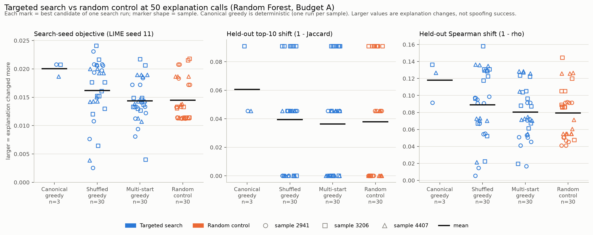
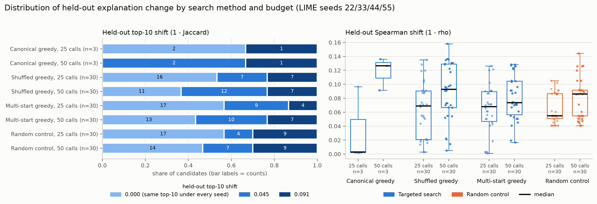
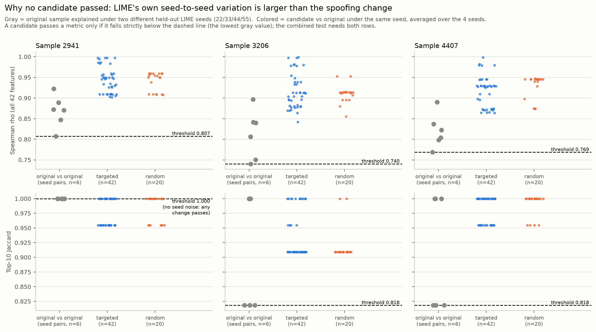
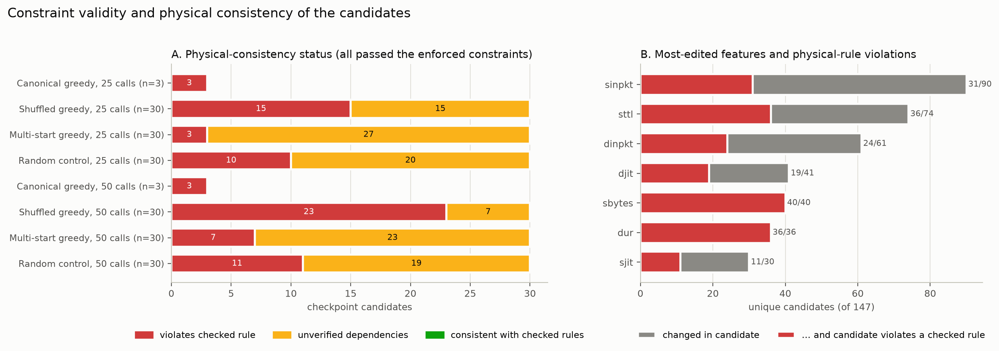
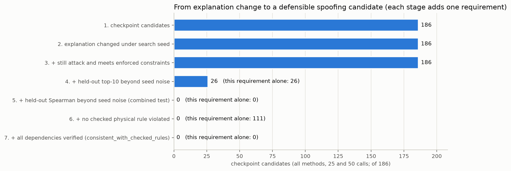

# Step 6 presentation outline: targeted vs random explanation spoofing

Wednesday group presentation, about 6 slides, 10-12 minutes.
All numbers come from `results/step6_shared/analysis_run_20261106_203918/` (commit `5da5a76` on `feature/step6-analysis`). Figure paths are relative to this file.

Wording to keep consistent throughout:
- **Search run**: one of the 123 experiments.
- **Candidate record**: the best modified flow a run found at 25 or 50 LIME calls. There are 186 records, which are 147 unique modified flows.

---

## Slide 1 - Step 6: can a search change LIME's explanation more than chance?

- Goal: make small, allowed edits to a detected attack flow so it is **still detected**, but its **LIME explanation changes**.
- Compared 3 **targeted** searches (canonical, shuffled and multi-start greedy) against a **random** baseline with the same LIME-call budget.
- Setup: Random Forest, 3 attack flows (2941, 3206, 4407), Budget A (at most 5 features, at most 10% each), 25 and 50 LIME calls.
- **123 of 123 search runs completed**, giving 186 candidate records. Each was tested on 4 *held-out* LIME seeds the search never saw.

**Visual:** a small design table.

| Method | Runs per sample | Seeds |
|---|---|---|
| Canonical greedy | 1 (deterministic) | - |
| Shuffled greedy | 10 | order 101-110 |
| Multi-start greedy | 10 per budget | order 101-110 |
| Random control | 10 | control 201-210 |

**Speaker notes:**
"In Step 6 we asked a simple question. If an attacker can only make small, realistic-looking changes to a malicious flow, can a smart search change the LIME explanation more than random changes can, and more than LIME's own randomness? We tested three greedy searches against a random baseline that gets exactly the same number of LIME calls. We used the Random Forest model, three attack flows, and the small perturbation budget. All 123 runs finished. One important design point: the search optimised against one LIME seed, seed 11, and we then re-checked every result on four other seeds it never saw. That's what keeps us honest about overfitting to LIME's noise."

---

## Slide 2 - Targeted vs random: no clear winner

- **25 calls:** random was as good as targeted or slightly better (pooled difference in held-out top-10 shift: -0.0045, 95% CI -0.015 to +0.007).
- **50 calls:** targeted was slightly ahead (+0.0011, 95% CI -0.010 to +0.012), but **every confidence interval for the seeded methods includes zero**.
- Canonical greedy was highest on all 3 samples at 50 calls, but it's **one deterministic run per sample (n=3)**, so we treat it as a lead, not a result.
- Multi-start was no better than random (-0.0015).

**Figure:** `../results/step6_shared/analysis_run_20261106_203918/figures/fig2_targeted_vs_random_50_calls.png`

Backup slide: `fig1_targeted_vs_random_25_calls.png` (the same layout at 25 calls).

**Speaker notes:**
"Each dot is the best result of one search run, and the marker shape tells you which of the three flows it was. Blue is targeted search, orange is the random baseline, and the black line is the mean. At 50 calls the blue means are a little higher, but look how much the dots overlap. When we compute confidence intervals within each sample, all of them cross zero for the shuffled and multi-start searches. Canonical greedy looks best, but it's deterministic, so we only have three numbers, one per flow. At 25 calls, random is actually equal or slightly better. So the honest summary is: targeted search catches up with random by 50 calls, but we can't say it beats it."

---

## Slide 3 - How big are the explanation changes?

- The held-out top-10 shift takes only 3 values: 0, 0.045 or 0.091. In other words, at most about one feature is swapped out of the top 10.
- **90 of 186 candidate records (48%)** have exactly the same top-10 as the original under every held-out seed.
- **At 50 calls the median top-10 shift is 0.045 for every method**; at 25 calls it is 0 for every method.
- Going from 25 to 50 calls left the top-10 result unchanged in most paired runs (e.g. shuffled: 6 up, 23 same, 1 down).

**Figure:** `../results/step6_shared/analysis_run_20261106_203918/figures/fig3_explanation_change_distributions.png` (optional backup: `fig4_budget_25_vs_50.png`)

**Speaker notes:**
"The changes we're talking about are small. On the left, each bar shows what share of candidates changed the top-10 features by zero, about half a feature, or about one feature, averaged over the four held-out seeds. Almost half the candidates didn't move the top 10 at all. The median at 50 calls is the same for every method, which is another reason we can't separate them. On the right is the rank-correlation version, which is a bit more sensitive and does grow with the budget. One caution: under the search seed the score can only go up with more calls, because it's the same run read at two points. So the meaningful check is the held-out seeds, and there the extra 25 calls rarely changed the top 10."

---

## Slide 4 - LIME's own randomness is bigger than the attack: 0 of 186 passed

- Same flow, two different LIME seeds: rank correlation only **0.74-0.92**; for flows 3206 and 4407 the **top feature changes in half of the seed pairs**.
- The combined test asks for a change beyond that noise on **both** top-10 overlap and rank correlation: **0 of 186 passed**.
- The closest candidate is still **about 0.09-0.10 above** the rank-correlation threshold in every sample, so this is not a near miss.
- The 26 top-10 passes all come from flow 2941, whose top 10 never changes across seeds. There a single swap counts, and **all 26 edited `sttl`**, its top feature.

**Figure:** `../results/step6_shared/analysis_run_20261106_203918/figures/fig5_lime_seed_stability.png`

**Speaker notes:**
"This is the key slide. The gray dots are the original flow explained twice with different random seeds, with nothing changed. The colored dots are our candidates compared with the original under the same seed. To pass, a candidate has to go below the dashed line, which is the lowest gray dot. On the top row, rank correlation, every colored dot sits well above the line. In other words, LIME disagrees with itself more than our attacks made it disagree. The bottom row shows the top-10 test. Flow 2941 is special because its top 10 never changed between seeds, so even one swapped feature beats the noise there. That's where all 26 top-10 passes come from, and every one of them changed `sttl`. Combined, zero candidates passed."

---

## Slide 5 - The edits are not physically consistent network traffic

- All 186 candidate records passed the **enforced** constraints and stayed classified as attacks.
- But **75 of 186 records (64 of 147 unique flows) break a checked traffic formula**. The other 111 change features whose dependencies can't be checked. **0 are consistent with all checked rules.**
- Every edit to **`sbytes` (40/40) or `dur` (36/36)** broke a formula such as `smean = round(sbytes/spkts)`, `sload` or `rate`. The search never updates the features calculated from them.
- Against our stricter feature table (reported only, not enforced): **106 of 186 records** are non-compliant (`dinpkt`/`djit` rated "Limited", `sbytes` decreased).

**Figure:** `../results/step6_shared/analysis_run_20261106_203918/figures/fig6_constraint_physical_consistency.png`

**Speaker notes:**
"Even if a candidate had passed the stability test, we'd have a realism problem. Our search only enforced the constraint rules in `constraints.py`. When we check the results against formulas that link network features, 75 of the 186 candidate records break at least one. For example, if you change the byte count you also have to change the mean packet size, and the search doesn't do that. The rest change features like `sttl` or the inter-packet times, whose dependencies we can't verify from the dataset. Not one candidate passes all the checks. Our stricter feature table flags 106 of 186 as non-compliant. That table isn't enforced yet, which is a decision we need to make as a team."

---

## Slide 6 - Conclusions, limitations, next steps

- **Conclusion:** under small, constrained edits we found *explanation changes*, but **no evidence of successful spoofing**. Targeted search was not clearly better than random.
- **Limitations:** 3 flows, 1 model, Budget A, 25/50 calls only; 24 exploratory comparisons without correction; SHAP was not computed for any modified flow.
- **Next:** finish the protocol (100 calls, Budget B, XGBoost), add more flows, and optimise against several LIME seeds instead of one.
- **Next:** repair dependent features during the search, and agree on one constraint policy.

**Figure:** `../results/step6_shared/analysis_run_20261106_203918/figures/fig7_spoofing_criteria_funnel.png`

**Speaker notes:**
"This chart puts it together. All 186 candidates changed the explanation under the seed the search used, and all of them stayed attacks within our enforced rules. Only 26 changed the top 10 beyond LIME's noise, none passed the combined test, and none are physically consistent. The numbers in brackets show that the physical requirement alone would already remove 75 of them. So we did not demonstrate spoofing. What we learned is that, at this budget, LIME's own randomness is the main obstacle to even measuring spoofing, and our edits need to respect how network features depend on each other. The limits are real: three flows, one model, and the smallest budget. Next we'll run the rest of the protocol, including XGBoost and larger budgets, make the search robust across LIME seeds, and fix the dependent features."

---

## Likely questions

- **"Is targeted search better than random?"** Not demonstrably in this run. The intervals include zero for shuffled and multi-start, and the medians are the same at 50 calls. Canonical's lead is n=3.
- **"Why not count the 26 top-10 passes as spoofing?"** They all come from one perfectly stable flow, all fail the rank-correlation half of the test, and none is physically clean (11 break a checked rule, 15 can't be verified).
- **"What about SHAP?"** Not computed for modified flows in Step 6. On the original flows, SHAP and LIME already disagree on the top 10 by 0.18-0.33 (Jaccard distance), more than any attack changed LIME (figure 8).
- **"Could more LIME samples fix the noise?"** Possibly. We used 5,000 samples. Testing a larger number is a reasonable next step, but we haven't run it.
- **"Why does `sttl` matter so much?"** It is LIME's top feature for flow 2941, and every top-10 pass edited it. Its link to `ct_state_ttl` isn't checked, so these edits may not be realistic either.
