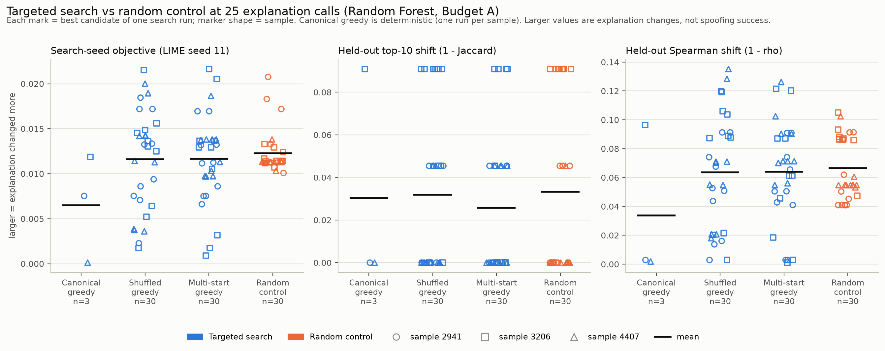
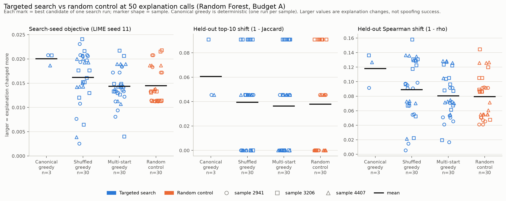
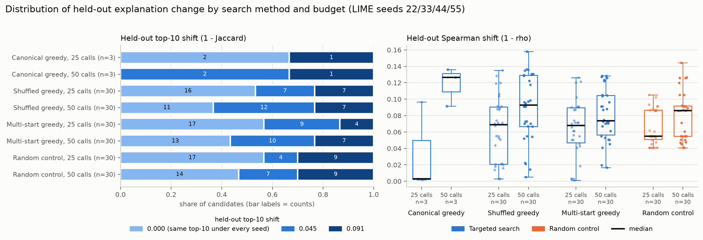
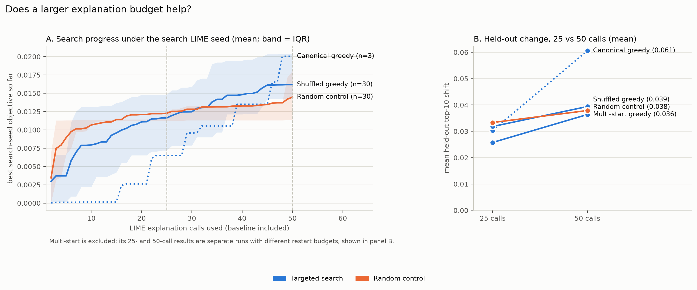
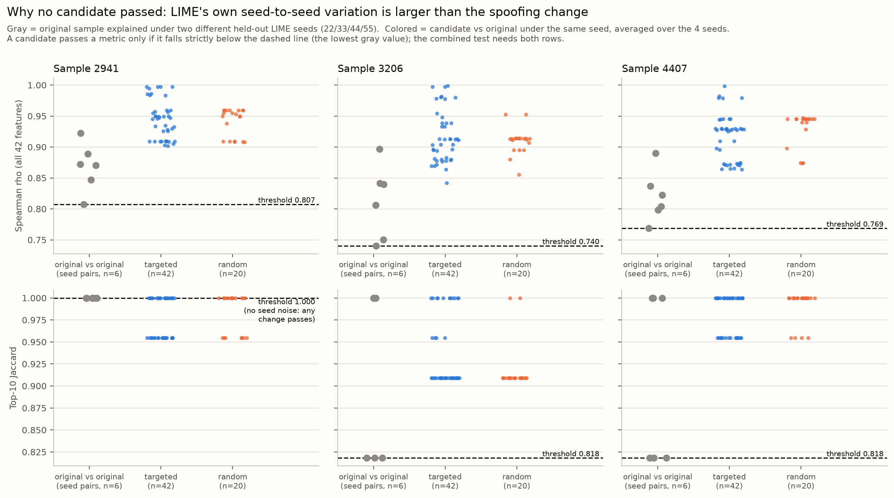
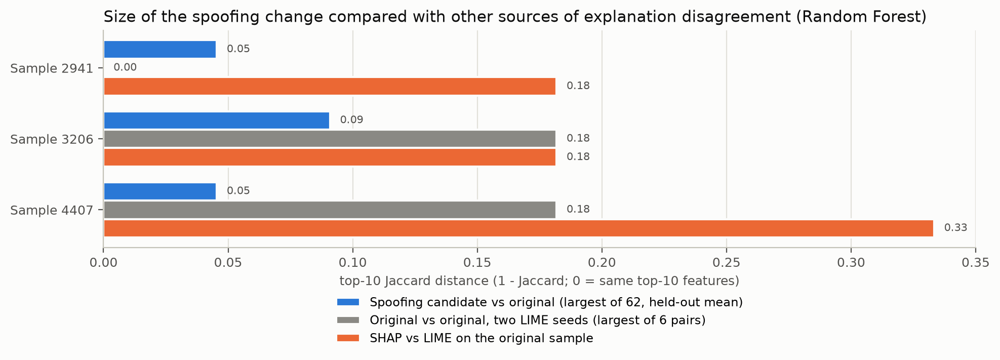
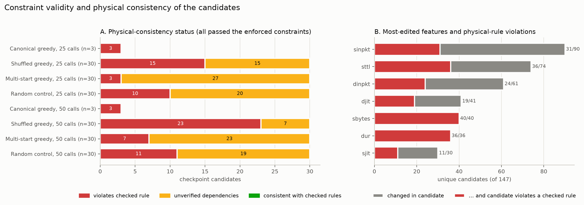
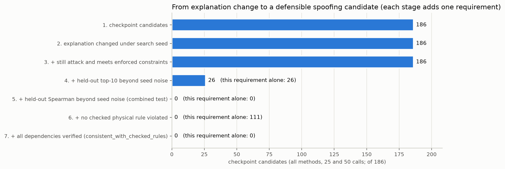

# Step 6 analysis: targeted vs random explanation spoofing (UNSW-NB15, Random Forest)

Source run: `results/step6_shared/run_20261106_203918` (protocol `step6-v1`, runner commit `5e3318b`, held-out run `run_20261106_205608`).
Generated by `python experiments/unsw_step6_analysis.py`. Every number below comes from the CSV tables in this folder; the file that holds each number is named next to it. Nothing was re-run: no model was loaded and no LIME or SHAP explanation was recomputed.

---

## 1. Research objective

Can an attacker make **small, constraint-respecting changes** to a malicious network flow so that it **is still detected as an attack** but its **LIME explanation changes**? Step 6 asks a narrower question first:

> Does a *targeted* search find bigger explanation changes than a *random* search with the same number of LIME calls, and are those changes bigger than LIME's own randomness?

## 2. Experiment setup

| Item | Value | Source |
|---|---|---|
| Dataset | UNSW-NB15. Internal validation split only; the official test set was not used (`official_test_used = false`) | `manifest.json` |
| Model | Random Forest pipeline (SHA-256 `4e49f17d...`). XGBoost is in the protocol but **not in this run** | `run_config.json` |
| Samples | 3 correctly detected attack flows: validation positions 2941 (Generic), 3206 (DoS), 4407 (Exploits) | `run_config.json`, `results/lime_stability` |
| Perturbation budget | **A only**: at most 5 changed features, each by at most 10% | `unsw_targeted_spoofing.BUDGET_POLICY` |
| Explanation budgets | **25 and 50** LIME calls per search, the original's baseline explanation included (100 is in the protocol but not run) | `run_config.json` |
| LIME | 5,000 samples, 42 features, quartile discretiser. Search seed **11**; held-out seeds **22, 33, 44, 55** | `manifest.json` |
| Tasks | **123 search runs, 123 completed, 0 failed** | `status.json`, `step6_validation_checks.csv` |
| Candidates analysed | **186** (the best candidate of each run at each valid checkpoint) | `heldout/heldout_summary.csv` |

### Search methods compared

| Method | What it does | Runs (per sample) | Seeds |
|---|---|---|---|
| **Canonical greedy** (targeted) | Greedy coordinate search in a fixed feature order. Deterministic | 1 | none |
| **Shuffled greedy** (targeted) | The same, with a shuffled feature/direction order | 10 | order seeds 101-110 |
| **Multi-start greedy** (targeted) | 3 shuffled climbs sharing one budget; a separate run for each budget | 10 per budget | order seeds 101-110 |
| **Random control** | Random valid candidates scored with the same objective; keeps the best | 10 | control seeds 201-210 |

Canonical, shuffled and random each ran once at 50 calls, and their 25-call result is the best candidate found within the first 25 calls. This is valid because the runner checks prefix equivalence (`checkpoint_valid = True` for all 186). Multi-start was run separately at 25 and at 50 calls.

### How explanation change is measured

| Measure | Definition | Role |
|---|---|---|
| **Search-seed objective** | `0.7*(1 - top10 Jaccard) + 0.3*(1 - Spearman)/2`, original vs candidate, **LIME seed 11 only** | What the search maximised. In-sample, so optimistic |
| **Held-out top-10 shift** | `1 - mean top-10 Jaccard` over seeds 22/33/44/55 (same seed for original and candidate) | Primary held-out measure |
| **Held-out Spearman shift** | `1 - mean Spearman rho` of the 42-feature ranking over the same seeds | Secondary held-out measure |
| **Seed-noise test** (Part B rule) | A candidate passes a metric if its mean is **strictly below the minimum** of the original sample's own seed-pair values (original vs original under two different seeds) | Is the change bigger than LIME randomness? |
| **Combined test** (`exceeds_heldout_both`) | Passes the top-10 test **and** the Spearman test | Main stability criterion |

Constraints are reported at three levels (`experiments/unsw_constraint_reporting.py`):
1. **Enforced policy** (`src/unsw/constraints.py` plus budget A). The search only kept candidates that passed it.
2. **Teammate feature table** (`results/unsw_nb15/network_feature_constraints.csv`). Reported only.
3. **Physical consistency**: 11 checkable formulas linking dependent features (for example `smean = round(sbytes / spkts)`). The best possible label is "consistent with checked rules". No candidate is ever called physically valid.

## 3. Data validation

All **22 checks pass** (`step6_validation_checks.csv`). The most important ones:
- Exactly the expected task grid: 3 canonical + 30 shuffled + 60 multi-start + 30 random = 123. All stopped at their explanation budget, all still classified as attack (lowest P(attack) = 0.87), all within the enforced constraints, and model-call accounting is consistent.
- The 186 held-out rows match the 186 checkpoints 1:1. The saved search scores were reproduced exactly (max gap 0).
- The held-out noise bands match the earlier Part B LIME-stability files (max gap 4e-13).
- No missing values in any metric column. Every missing value in the inputs is structural: for example, canonical has no order seed, and an empty `physical_violations` field means no violation (`step6_missing_values.csv`).

## 4. Key results

### 4.1 Targeted vs random

Pooled comparison, all targeted methods vs the random control, averaged within sample with each sample weighted equally (`step6_targeted_vs_random.csv`):

| Calls | Measure | Targeted mean (n=63) | Random mean (n=30) | Difference [95% bootstrap CI] | P(targeted > random) |
|---|---|---|---|---|---|
| 25 | Search-seed objective | 0.0114 | 0.0123 | -0.0009 [-0.0024, +0.0006] | 0.50 |
| 25 | Held-out top-10 shift | 0.0289 | 0.0333 | -0.0045 [-0.0149, +0.0066] | 0.49 |
| 50 | Search-seed objective | 0.0155 | 0.0145 | **+0.0010** [-0.0008, +0.0027] | 0.64 |
| 50 | Held-out top-10 shift | 0.0390 | 0.0379 | **+0.0011** [-0.0095, +0.0122] | 0.53 |
| 50 | Held-out Spearman shift | 0.0863 | 0.0794 | +0.0069 [-0.0058, +0.0190] | 0.63 |

By method at **50 calls** (`step6_method_summary.csv`, `step6_targeted_vs_random.csv`):

| Method | n | Search-seed objective | Held-out top-10 shift | Held-out Spearman shift | Difference vs random, held-out top-10 |
|---|---|---|---|---|---|
| Canonical greedy | 3 | **0.0200** | **0.0606** | **0.1181** | +0.023 (higher on all 3 samples; see caveat) |
| Shuffled greedy | 30 | 0.0162 | 0.0394 | 0.0889 | +0.0015 [-0.012, +0.015] |
| Multi-start greedy | 30 | 0.0144 | 0.0364 | 0.0805 | -0.0015 [-0.014, +0.012] |
| Random control | 30 | 0.0145 | 0.0379 | 0.0794 | (reference) |

**What this means:**
- At **25 calls**, random is as good as targeted or slightly better. Canonical greedy is clearly worse on the search objective at this budget (0.0065 vs 0.0123).
- At **50 calls**, the targeted means are slightly higher overall. Every interval includes zero except canonical's. The median held-out top-10 shift is **0.045 for every method**.
- **Canonical greedy** is the only method that is higher than random on all three samples at 50 calls. But it has only **one deterministic run per sample (n=3)**. Its bootstrap interval excludes zero only because canonical has no run-to-run variation to resample, so that interval understates the uncertainty. Its permutation p-values are 0.028 (objective), 0.22 (held-out top-10) and 0.019 (held-out Spearman). These are 3 of 24 uncorrected comparisons, so treat them as a lead to follow up, not a result.

### 4.2 Distribution of explanation change

The held-out top-10 shift can only take three values here: 0, 0.045 or 0.091. In other words, either the top-10 list never changes, or about one feature is swapped in some seeds. **90 of 186 candidates (48%)** have **exactly the same top-10 under every held-out seed** as the original: 37-57% for each seeded method and budget, 2 of 3 for canonical at 25 calls, and 0 of 3 at 50 calls.

### 4.3 Effect of the budget (25 to 50 calls)

From `step6_budget_effect.csv`, comparing paired runs:

| Method | Held-out top-10 shift, 25 to 50 | Pairs up / same / down | Held-out Spearman shift, 25 to 50 |
|---|---|---|---|
| Canonical | 0.030 to 0.061 | 2 / 1 / 0 (of 3) | 0.034 to 0.118 |
| Shuffled | 0.032 to 0.039 | 6 / 23 / 1 (of 30) | 0.064 to 0.089 |
| Multi-start | 0.026 to 0.036 | 4 / 26 / 0 (of 30) | 0.064 to 0.081 |
| Random | 0.033 to 0.038 | 4 / 25 / 1 (of 30) | 0.067 to 0.079 |

- Under the **search seed**, more calls can never make the result worse for canonical, shuffled and random. They are the same run read at two points, so "it went up" is guaranteed by construction and is not evidence on its own.
- On **held-out seeds**, the extra 25 calls changed the top-10 result in only a few runs (most pairs are unchanged). The Spearman shift grows more consistently.
- The greedy searches start slowly but keep improving. The random control gains quickly in its first ~10 calls and then levels off (figure 4A). This is consistent with targeted search only catching up with random at around 30-50 calls.

### 4.4 LIME stability across random seeds

| Sample | Original vs original, held-out seed pairs (n=6): top-10 Jaccard min / mean | Spearman min / mean | Top-1 stable? | Best candidate: top-10 / Spearman mean |
|---|---|---|---|---|
| 2941 | **1.000** / 1.000 | 0.807 / 0.868 | yes | 0.955 / 0.902 |
| 3206 | 0.818 / 0.909 | 0.740 / 0.812 | no (agreement 0.5) | 0.909 / 0.842 |
| 4407 | 0.818 / 0.909 | 0.769 / 0.820 | no (agreement 0.5) | 0.955 / 0.864 |

(`step6_lime_stability.csv`, `step6_noise_margins.csv`)

- LIME is **not very stable** with 5,000 samples. Explaining the *same* flow with two different seeds already gives a Spearman correlation of only 0.74-0.92. For 3206 and 4407, the top-ranked feature itself changes between seeds in half of the seed pairs.
- A candidate's change is measured under the *same* seed as the original, so the comparison is fair. Even so, the candidate's ranking stays closer to the original (Spearman 0.84-1.00) than the original stays to itself under a different seed.

### 4.5 Why no candidate passed the combined test

| Test | Candidates passing (of 186) |
|---|---|
| Held-out top-10 beyond seed noise | **26** |
| Held-out Spearman beyond seed noise | **0** |
| **Combined (both)** | **0** |
| Held-out top-1 rule | 0 |
| Part B combined test (seeds 11-55, not held out) | 0 |

There are three reasons, based on the data:
1. **The Spearman test is far from being met.** The closest candidate in each sample still has a Spearman correlation **0.094-0.102 above** the threshold (for example 0.902 vs 0.807 for sample 2941). This is not a near miss.
2. **The 26 top-10 passes are not strong evidence.** All 26 come from **sample 2941**, which is the only sample whose top-10 never changes between seeds (threshold = 1.000). Swapping one feature in 2 of the 4 seeds is enough to pass there. In samples 3206 and 4407, no candidate changed the top-10 more than LIME's own noise does.
3. **Budget A changes are small.** At most 5 features each move by at most 10%. A likely reason, **not tested in this analysis**, is that LIME bins continuous features into quartiles: an edit that doesn't move a value into a different bin barely changes what LIME's surrogate sees. Checking this would need the quartile edges from the training data. The data does show that the change depends on *which* feature is edited. In sample 2941, **every candidate that changed `sttl` passed the top-10 test (26/26), and none of the 36 that left it alone did**. `sttl` is that sample's top LIME feature.

### 4.6 SHAP vs LIME

Step 6 has **no SHAP outputs**: SHAP was not computed for any candidate, so it is not possible to say whether SHAP would also change. The only comparison possible uses the earlier SHAP-vs-LIME results for the three **original** samples (`step6_shap_lime_context.csv`). There, SHAP and LIME disagree on the top-10 list by 0.18-0.33 (Jaccard distance) and on the full ranking (Spearman of |attribution| 0.54-0.63). That is **2-7 times larger** than the biggest spoofing change (0.045-0.091). For sample 2941, SHAP's top feature is `service` while LIME's is `sttl`. Practical point: a change that LIME's own randomness can hide would also be lost in the normal disagreement between explainers.

### 4.7 Constraint validity and physical consistency

All 186 candidates passed the **enforced** constraint policy and stayed classified as attack. Under the stricter checks (`step6_constraint_status.csv`, `step6_constraint_details.csv`):

| Physical status | Checkpoint rows (186) | Unique candidates (147) |
|---|---|---|
| Violates a checked rule | **75** | **64** |
| Unverified dependencies | 111 | 83 |
| Consistent with all checked rules | **0** | **0** |

- **Most violated rules** (unique candidates): `smean = round(sbytes/spkts)` (40), `sload = (sbytes - smean)*8/dur` (39), `rate = (spkts+dpkts-1)/dur` (36).
- **Which edits cause the violations:** every candidate that edited **`sbytes` (40/40) or `dur` (36/36)** breaks a checked rule. This happens because the search changes these features without updating the features that are computed from them.
- **Unverified edits:** `sinpkt`, `sttl`, `dinpkt`, `djit` and `sjit` have known dependencies that can't be checked from the 42 features (for example, `sttl` determines `ct_state_ttl`).
- **Teammate table** (reported only, not enforced by the search): 106 of 186 checkpoint rows (85 of 147 unique candidates) are *non-compliant*, mainly because of `dinpkt`/`djit` (rated "Limited") and `sbytes` being decreased although it is rated "increase only". Another 51 rows need review (mainly `sttl`), and only 29 are compliant.
- **By method:** all 6 canonical candidate records violate a checked rule. Among the seeded methods, shuffled greedy at 50 calls has the most violations (23 of 30) and changes the most features (mean 3.8). The random control has 11 of 30 and multi-start 7 of 30.

### 4.8 Explanation change is not successful spoofing

All 186 candidates changed the explanation under the search seed and met the enforced constraints. Only 26 changed the held-out top-10 beyond noise, **none** passed the combined test, and **none** would also be consistent with all checked physical rules. The physical requirement alone already rules out 75 candidates.

## 5. Checking my teammate's initial findings

| Claim | Verdict | Evidence |
|---|---|---|
| All 123 experiments completed successfully. | **Supported** | 123/123, no failures, all within budget, all still attacks, accounting consistent. |
| Targeted search generally performed better than random search at 50 evaluations. | **Not supported as stated** | The pooled targeted mean is slightly higher (objective +0.0010, held-out top-10 +0.0011), but every interval includes 0, the medians are equal, and multi-start is no better than random. Only canonical greedy (n=3, deterministic) is consistently higher. A fairer summary: "At 50 calls the targeted methods catch up with random. Canonical greedy is higher on all three samples, but with n=3 this is not established." |
| No candidates passed the combined LIME stability test. | **Supported** | 0/186 on the combined held-out test, the Part B test and the top-1 rule. |
| Some modified records had physical-consistency problems. | **Supported, but understated** | 75/186 checkpoint rows (64/147 unique candidates) violate a checked rule, and **none** is consistent with all checked rules. The rest have dependencies that can't be checked. |

(`step6_claims_check.csv`)

## 6. Main conclusions

**Supported by the data**
1. The Step 6 pipeline is complete and internally consistent (22/22 checks).
2. Under Budget A with 25 or 50 LIME calls, **no search method produced an explanation change larger than LIME's own seed-to-seed variation** on the combined test.
3. **Targeted search is not clearly better than random.** Random is equal or better at 25 calls. At 50 calls the difference is small and uncertain.
4. Increasing the budget from 25 to 50 calls increases the in-sample objective (guaranteed by construction) and the held-out Spearman shift, but rarely changes the held-out top-10 list.
5. Every candidate either breaks a checked physical rule or depends on rules that can't be checked. None is a physically realistic flow by the checks available.

**Still uncertain**
- Whether canonical greedy's lead at 50 calls is real (only 3 deterministic runs).
- Whether larger budgets (100 calls, Budget B) or XGBoost behave differently. **None of these were run.**
- Whether SHAP explanations of the candidates change (not computed).
- Whether the results generalise beyond 3 samples and one model.
- Which "unverified" candidates would be physically realistic.

## 7. Recommendations for next experiments

1. **Finish the predeclared protocol:** 100 calls, Budget B, and XGBoost (stages 2-3 in `step6_protocol.json`). XGBoost is interesting because its LIME explanations are less stable (mean top-10 Jaccard 0.54-0.59 for 3206/4407 in Part B), which raises the bar even further.
2. **Make the search aware of stability:** optimise the objective averaged over several LIME seeds instead of seed 11 only, so it doesn't overfit one seed's noise.
3. **Repair dependent features during the search** (recompute `smean`, `sload`, `rate` after changing `sbytes` or `dur`), or ban unrepaired edits. Then the reported violations become a design choice, not an accident.
4. **Agree as a team on one constraint policy** (`constraints.py` vs the feature table). 106/186 candidates break the stricter table.
5. **Add more samples** (at least 10-20) so that sample-level differences, such as 2941's perfectly stable top-10, don't dominate the result.
6. **Compute SHAP for a subset of candidates** to answer the SHAP-vs-LIME question directly.
7. Consider **more LIME samples** (more than 5,000) to reduce seed noise before testing for spoofing.

## 8. Talking points for Wednesday

1. "We ran all 123 planned searches. Every one finished, stayed classified as an attack, and met our enforced constraints."
2. "We compared three targeted searches against a random baseline with the same number of LIME calls."
3. "Random is as good as targeted at 25 calls. At 50 calls targeted catches up, but the difference is small and not statistically clear. Canonical greedy looks best, but that's only three runs."
4. "The key finding is about LIME itself. Explaining the *same* flow with a different random seed changes the explanation more than any of our attacks did. So **no candidate passed our combined stability test: 0 out of 186**." (Show figure 5.)
5. "The only 'passes' on the top-10 test come from one sample whose top-10 list never changes. There, moving one feature is enough, and every one of those passes edited `sttl`, its most important feature."
6. "The edits also have a realism problem. Changing `sbytes` or `dur` always broke a traffic formula such as `smean = sbytes/spkts`, and none of the 147 unique candidates passed all our physical checks."
7. "So our conclusion is: under small, constrained edits, we found **explanation changes but no evidence of successful spoofing**."
8. "Next: bigger budgets, XGBoost, a search that is aware of LIME's randomness, and repairing dependent features."

Likely questions:
- *"Is targeted better than random?"* Not demonstrably in this run. The confidence intervals include zero, and the medians are identical at 50 calls.
- *"Why not just say spoofing worked for 26 candidates?"* Those passes are all on one perfectly stable sample and all fail the Spearman half of the test. None of them is physically clean either: 11 break a checked rule and the other 15 have unverified dependencies.
- *"What about SHAP?"* Not computed in Step 6. On the original samples, SHAP and LIME already disagree more than our attacks changed LIME.

## 9. Limitations of this analysis

- Statistics are **exploratory**: 3 samples, 24 uncorrected comparisons, and bootstrap/permutation within sample. The intervals for canonical (n=1 per sample) don't reflect run-to-run uncertainty.
- The held-out top-10 shift is coarse (three possible values), so small differences between methods aren't measurable with it.
- Only Random Forest, Budget A, and 25/50 calls are in this run.
- **Reproducibility note:** the local `results/models/random_forest_validation_pipeline.joblib` (dated 2026-10-28) has SHA-256 `2f39fbff...`, not the `4e49f17d...` model used in Step 6. As a result, two of my teammate's tests (`test_manifest_is_written_hashed_and_linked`, `test_resolved_manifest_is_valid_and_complete`) fail on this machine. The analysis is not affected because it never loads a model, but **re-running any search here would use a different model**. Get the Step 6 model file before running new experiments.

## 10. Files in this folder

| File | Content |
|---|---|
| `step6_validation_checks.csv` | 22 completeness and consistency checks |
| `step6_missing_values.csv` | Every missing value and its reason |
| `step6_candidates.csv` | One row per checkpoint candidate (186), with all metrics and constraint fields |
| `step6_method_summary.csv`, `..._by_sample.csv` | n, mean, median, SD, min, max and success counts/rates by method x budget (x sample) |
| `step6_seed_summary.csv` | Per order/control seed |
| `step6_targeted_vs_random.csv`, `..._by_sample.csv` | Differences, bootstrap CIs, P(superiority), permutation p |
| `step6_budget_effect.csv` | Paired 25 to 50 changes |
| `step6_best_so_far_curves.csv` | Search progress per call |
| `step6_lime_stability.csv`, `step6_noise_margins.csv` | Seed-noise bands and distances to the thresholds |
| `step6_shap_lime_context.csv` | Spoofing change vs LIME noise vs SHAP-LIME disagreement |
| `step6_constraint_status.csv`, `step6_constraint_details.csv` | Constraint and physical-consistency summaries |
| `step6_spoofing_funnel.csv` | Cumulative criteria |
| `step6_claims_check.csv`, `step6_key_findings.csv` | Claim verification and compact findings |
| `figures/fig1-fig8_*.png` | Figures used above |
| `analysis_metadata.json` | Inputs, statistical settings and output list |
